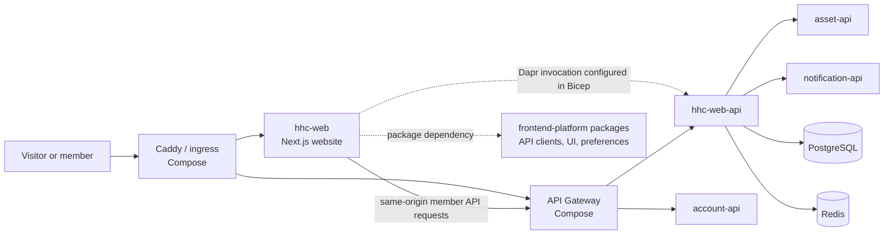

# HHC Web Architecture

> Analysis date: 2026-10-20  
> Scope: This repository's source code, build and deployment configuration, and directly verifiable shared frontend package dependencies. This document describes the architecture expressed by the code and configuration; it does not claim that the current production environment has been verified.

## Summary

`hhc-web` is HHC's public website frontend and Next.js server runtime. It uses the App Router, React, TypeScript, and `next-intl`. Routes live in `src/app`, business logic is organized by domain in `src/features`, reusable UI is in `src/components`, and platform capabilities are integrated through SDK, UI, and shared preference packages published by `frontend-platform`.

The website calls services such as HHC Web API, Account API, and Operations API. The production Bicep configuration sets up the website to invoke HHC Web API through Dapr. The local Compose file describes a broader integration environment, including Caddy, API Gateway, Account, Asset, Notification, HHC Web API, PostgreSQL, and Redis. The backend source repositories are not available in the current workspace, so their internal implementation and production deployment state are outside this document's verified scope.

## System Boundary and Topology

The frontend package dependency shown above is not a runtime service; it is supported by this repository's `package.json`, lockfile, and source imports. The ingress and backend service connections come from `compose.yaml`, source request paths, and the architecture design document. Compose build contexts point outside the current workspace, so they establish only what this repository's environment configuration declares; they do not verify service implementations or whether the services are running.

| Unit | Responsibility and boundary visible in this repository | Evidence |
|---|---|---|
| `hhc-web` | Multilingual public website and frontend features such as member videos and weekly bulletin reading; runs as a Next standalone server | `src/app/`, `src/features/`, `Dockerfile` |
| `frontend-platform` | Provides HHC Web, Account, and Operations API clients, UI, and shared preference packages | `package.json`, `src/features/*/api.ts`; adjacent `../frontend-platform/packages/*/package.json` |
| `api-gateway` | API gateway behind Caddy in the Compose environment; depends on Account, HHC Web, and Asset APIs | `compose.yaml`; platform design document |
| `account-api` | Account API in Compose; depends on Notification and Asset APIs | `compose.yaml`; platform design document |
| `hhc-web-api` | Website API in Compose; configured to connect to the HHC Web PostgreSQL database and Redis, and to call Asset API | `compose.yaml`; platform design document |
| `asset-api` | Configured with a separate asset database and file storage; used by Account and HHC Web APIs | `compose.yaml` |
| `notification-api` | Internal notification service in Compose; called by Account API | `compose.yaml` |

The platform architecture document also lists services such as `audit-log` and `hhc-line-function-bot`. They are not defined as services in this repository's `compose.yaml`, so they are excluded from the local Compose topology.

## Frontend Structure

| Path | Responsibility |
|---|---|
| `src/app/` | Next.js App Router pages, layouts, metadata, and a small number of Route Handlers. Most pages are under `src/app/[locale]/`. |
| `src/features/` | Domain API wrappers, types, state, and feature logic, including `weekly-reader`, `member-videos`, `organizations`, `news`, and `statements`. |
| `src/components/` | Shared UI and view components for larger features, including `layout`, `ui`, and `weekly-reader`. |
| `src/lib/` | Cross-feature utilities such as CSP, SEO, Account API proxying, observability, private cover caching, and Service Worker capabilities. |
| `src/i18n/` | `next-intl` request configuration, locale navigation, and messages for five locales: `zh-Hant`, `zh-Hans`, `en`, `ja`, and `ko`. |
| `public/` | Static media and versioned weekly reader assets. |

Major App Router pages cover the home page, About, News, Literature Ministry / weekly bulletins, member videos, Organizations, statements, and legal documents. Route Handlers are primarily support endpoints such as `/health` and `/csp-report`; feature modules call the shared SDKs for most business APIs.

## Representative Request Paths

### Public content

`src/features/content/client.ts` uses `@hallelujahhomechurch/hhc-web-client` to create a public content client. Its base URL is selected from settings including `HHC_WEB_API_BASE_URL`. The default fetch revalidates after 60 seconds; callers can request a fresh response with `no-store`. The production Bicep configuration sets `HHC_WEB_API_BASE_URL` to the Dapr invocation URL for `hhc-web-api`.

### Member operations

`src/features/weekly/api.ts` creates a protected fetch wrapper. It reads the access token, adds the Authorization header, attempts a token refresh after a 401, and notifies the frontend to enter the legal-document acceptance flow after a 428. Member video and organization management also have feature-specific API wrappers. The Next.js rewrite can proxy the Account API locally; `next.config.ts` leaves other API routing to the gateway in production.

### Weekly reader and local storage

Online reading uses the HHC Web client in `src/features/weekly-reader/api.ts` to open documents, fetch private reader state, and submit updates. It validates bindings such as account, document revision, receipt, and renderer assets. Offline saves and private reader state also use browser storage such as IndexedDB. As a result, the reader's local persisted data, versioned renderer assets, and online API contract together form its compatibility boundary.

## Data and Security Boundaries

- Public content is retrieved through the HHC Web API client; this repository does not contain the website's primary CMS database access layer.
- Compose configures `hhc-web-api` and `asset-api` to use separate PostgreSQL databases; `hhc-web-api` also has a Redis setting. This is environment configuration evidence, not independent verification of backend schemas or data ownership.
- Private video covers use authenticated same-origin requests and account-bound caching. The README states that private covers do not pass through the public Next Image optimizer or Service Worker response cache.
- `next.config.ts` sets `private, no-store` and `noindex, nofollow` response headers for organization pages.
- Cross-feature security support such as CSP, Account proxying, legal return URL handling, and browser bootstrap lives under `src/lib/`. Actual security guarantees still need to be checked against backend and gateway contracts.

## Build and Deployment

- `package.json` specifies pnpm 10.12.1 and Node.js `>=22`. Scripts cover Next.js development/build/start, ESLint, Vitest, and static performance checks.
- `Dockerfile` builds the Next standalone output with Node 22, then copies it into a distroless Node runtime that listens on port `10000` by default.
- `infra/main.bicep` defines an Azure Container App, User Assigned Managed Identity, Dapr, resource limits, and scaling range. The website startup/liveness probes check `/health`; the readiness probe checks the Dapr health endpoint on port `3501`.
- `.github/workflows/ci.yml` defines pull request verification. `.github/workflows/release.yml` defines the production release flow, including dependency and image scanning, build, post-deployment checks, and rollback steps for a failed update.
- These are build and deployment definitions in the repository. Azure resources, the deployed image digest, production routes, and UAT were not inspected, so this configuration does not establish that production is currently operating this way.

## Architectural Constraints and Open Questions

1. **Shared packages are a frontend and API contract boundary.** This repository pins published versions of `hhc-web-client`, Account / Operations clients, UI, and preferences. Changes to shared contracts may require a package release and consumer upgrade; the lockfile records the versions installed by this repository.
2. **Offline reader data must remain compatible across versions.** The Reader API validates document and renderer assets, and offline data persists in the browser. Changes to data formats or assets can affect existing offline content. Evidence: `src/features/weekly-reader/api.ts`, offline store modules, and the README's offline policy.
3. **Backend implementation and deployment state remain unverified.** Compose build contexts such as `../account/account-api`, `../hhc-web-api`, and `../asset-api` do not exist in the current workspace. Their actual APIs, tables, authorization rules, and runtime health cannot be checked from service source here.
4. **Design intent must be distinguished from current configuration.** `docs/superpowers/specs/2026-07-08-hhc-web-platform-detailed-architecture.md` describes the platform design; `compose.yaml` and `infra/main.bicep` describe the local and Azure configuration visible in this repository. The design document alone is not evidence of deployment or production behavior.

## Primary References

- `package.json`, `pnpm-lock.yaml`
- `src/app/`, `src/features/`, `src/components/`, `src/lib/`, `src/i18n/`
- `src/features/content/client.ts`, `src/features/weekly/api.ts`, `src/features/weekly-reader/api.ts`
- `next.config.ts`, `Dockerfile`, `compose.yaml`, `infra/main.bicep`
- `.github/workflows/ci.yml`, `.github/workflows/release.yml`
- `README.md`
- `docs/superpowers/specs/2026-07-08-hhc-web-platform-detailed-architecture.md`
- Shared package manifests under adjacent `../frontend-platform/packages/` (used only to confirm package names, purpose, and source repository)

